# Entangled

### Hold a qubit in your hand.

Entangled turns your hands into a quantum computer. Pinch a qubit and twist your
wrist to rotate it, spread your fingers for a Hadamard, close your fist to
measure, touch two orbs together and watch a gold thread of entanglement appear
between them. Every number on screen comes from a real simulator, and when you
are ready, the same circuit runs on a 3D trapped-ion trap, a neutral-atom
array, a superconducting chip in its dilution refrigerator, or a real IBM
quantum computer.

Built for the Meta VR Start Developer Competition 2026 (Productivity track) with
the Meta Immersive Web SDK (IWSDK), three.js and TypeScript.

<p align="center">
  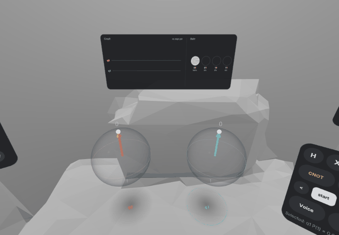
</p>
<p align="center"><sub>"Hadamard on qubit zero." "Entangle zero and one." "Run 100 shots." Every shot lands on 00 or 11.</sub></p>

## Why it is different

- **Your hands are the interface.** Five natural gestures do the work of a
  quantum programming language, a ghost hand demonstrates each one, and every
  gesture also has a button, a key and a voice command.
- **Real physics, not animation.** Statevector and density-matrix simulators,
  Born-rule measurement, honest Bloch arrows that shrink when qubits entangle,
  entanglement measured as negativity, noise that matches Qiskit to 3e-16, and
  circuits that export to Qiskit, OpenQASM 3 and PennyLane.
- **Three quantum computers in 3D, at full size.** Watch lasers address a
  chain of trapped ions, atoms get sorted one by one in optical tweezers, or
  pulses travel down a dilution refrigerator to a superconducting chip. Press
  Full size and the machine stands beside your desk at its real size: a 2.4 m
  cryostat whose vacuum cans slide away while it cools to 15 mK. Then compare
  all three on the same circuit.
- **See what no textbook can show.** The many-worlds view draws every path a
  computation takes through its basis states, so interference is something you
  watch: strands of opposite colour meet and cancel. And the surface code from
  Google's Willow chip runs live on a 49-qubit lattice above your desk.
- **From the first qubit to research topics.** A 14-module course with quizzes,
  26 chapters from superposition to Shor's algorithm, VQE for the H2 molecule, a
  Bell test, error correction, quantum walks, randomized benchmarking and the
  surface code.
- **Learn together.** Shared labs where two people each hold half of a Bell
  pair, and classes where a teacher assigns modules, watches progress and
  students earn certificates.
- **A Play tab full of wonders.** Quantum dice, Schrodinger's cat, the quantum
  penny flip, a State Album of fifteen famous states to collect, a room-sized
  Bloch sphere to sit inside, a transmon qubit up close, a night sky, a history
  gallery from 1981 to Willow, and ambient music that follows the state.
- **A reason to come back.** Quantum Rush, an arcade round where you build
  target states against the clock with combos; a daily challenge whose par is
  provably optimal; streaks, 28 achievements, levels, and orb finishes you
  unlock as you level up.

## Highlights

| Quantum Rush: build the target before the clock runs out | The surface code, live, on 49 qubits |
| --- | --- |
| 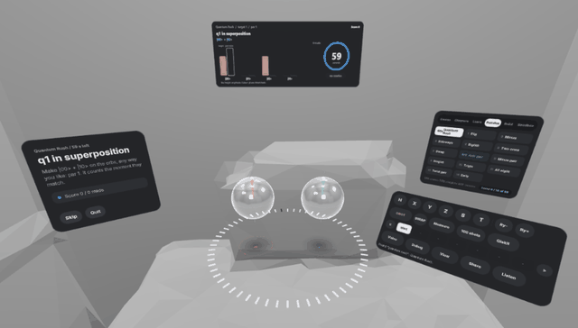 | 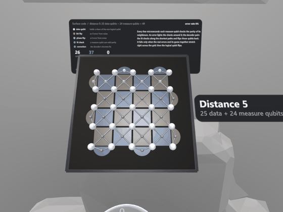 |
| **A quantum computer opens and cools to 15 mK** | **Every path at once: interference you can see** |
| 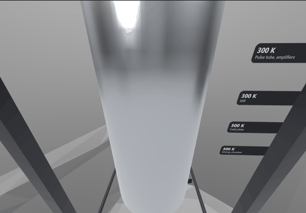 | 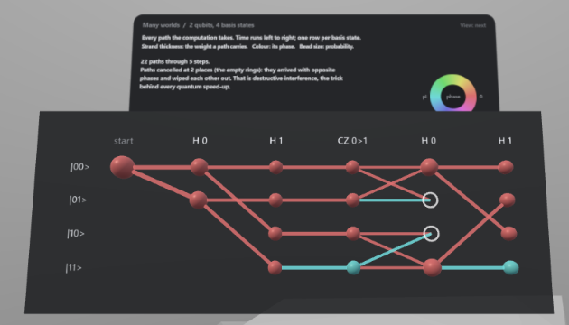 |
| **The same circuit on three machines** | **Beat the classical limit** |
| 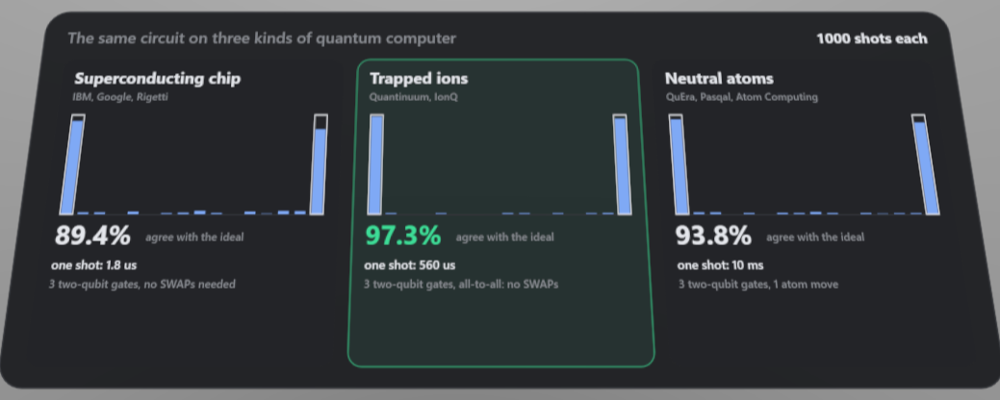 | 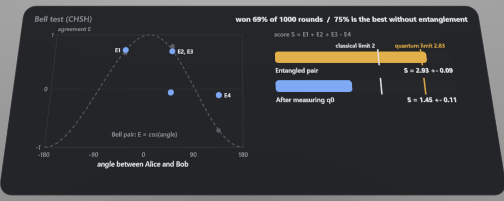 |
| **Life-size, beside your desk** | **On your real desk, in mixed reality** |
| 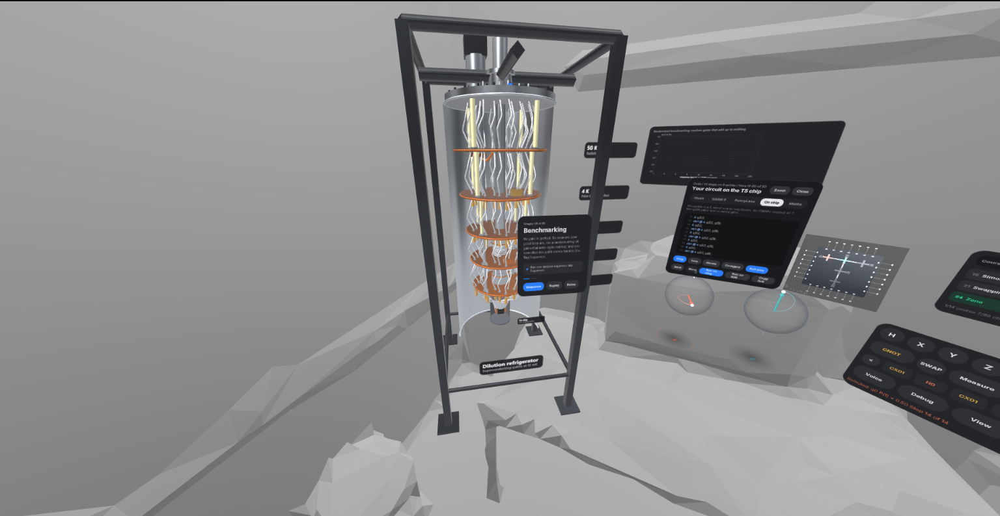 | 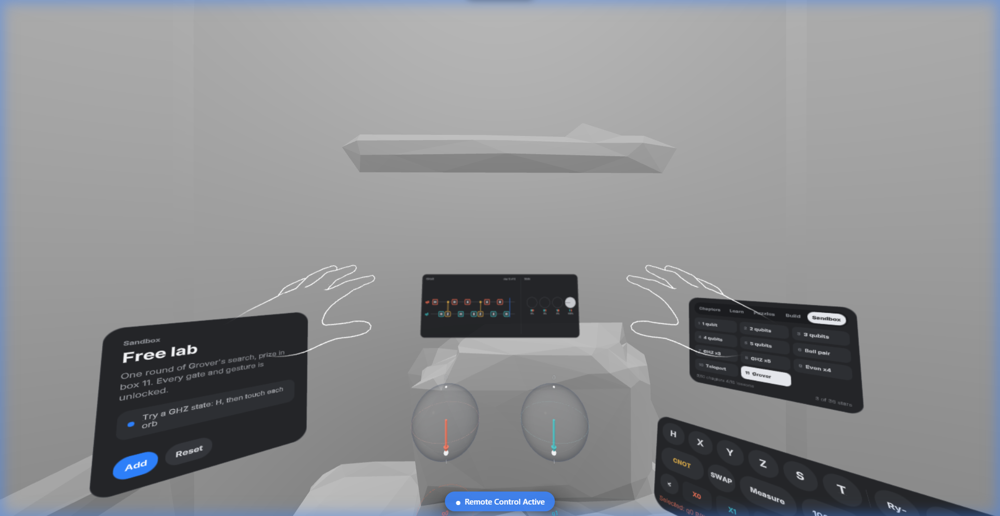 |
| **Step inside the Bloch sphere, under the stars** | **Inside a qubit: a transmon, a thousand times bigger** |
| 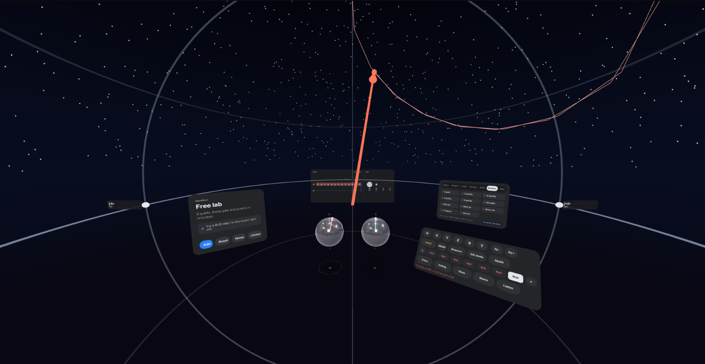 | 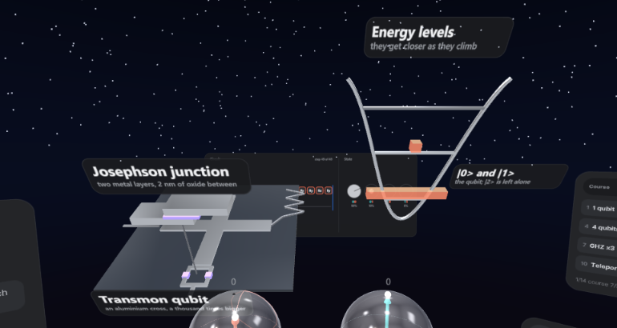 |
| **Every achievement is a 3D trophy** | **Life-size, in a glass case** |
| 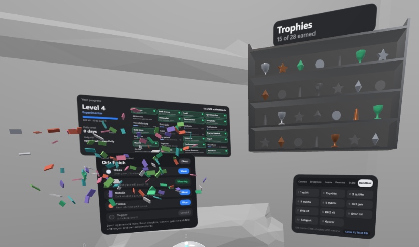 | 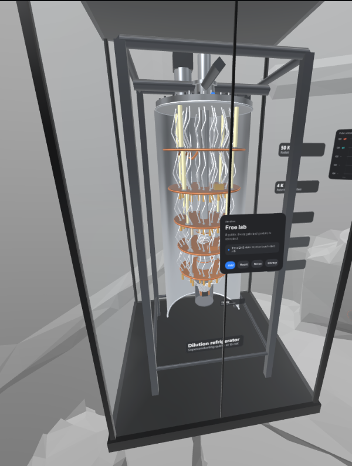 |
| **Atoms carried into place to entangle** | **Orb finishes you unlock** |
| 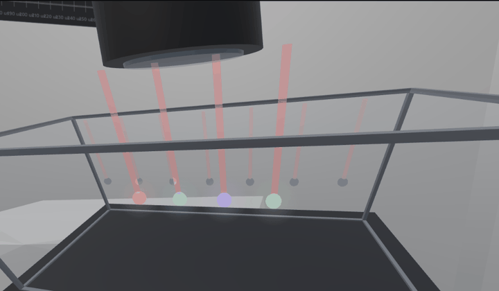 | 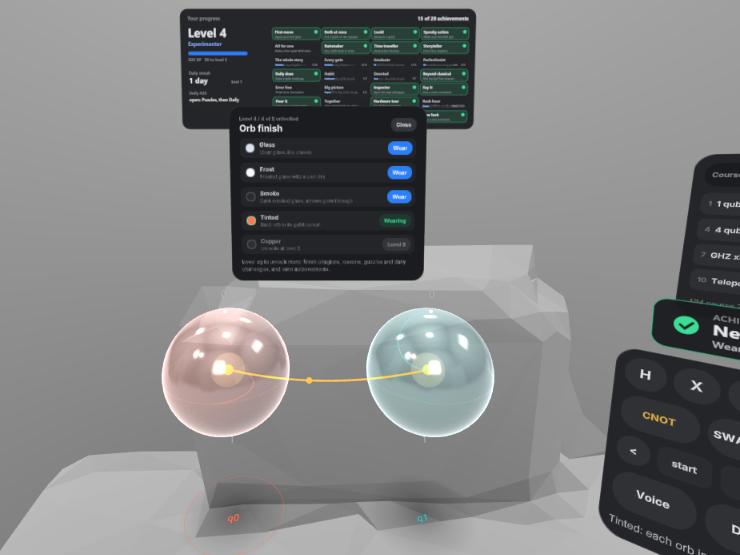 |

**By the numbers:** 26 chapters, a 14-module course, 21 lessons, 12 puzzles, a
daily challenge and Quantum Rush, a Play tab, 5 big-state views, 3 kinds of quantum computer
in 3D at full size, a 49-qubit surface code, 34 achievements, 5 orb finishes, 21 Play tab items, daily quests,
voice control, shared labs and classes, and 334 unit tests.

## Contents

- [Try it](#try-it)
- [Part 1: Your hands are the quantum computer](#part-1-your-hands-are-the-quantum-computer)
  - [Gestures](#gestures), [Gates you can see](#gates-you-can-see), [Circuit board](#circuit-board), [Sandbox](#sandbox), [Share links](#share-links)
- [Part 2: Learn, from the first qubit to research topics](#part-2-learn-from-the-first-qubit-to-research-topics)
  - [Course](#course), [Learn](#learn), [Qubiting: five new lessons](#qubiting-five-new-lessons), [Notes](#notes), [The Mystery Qubit](#the-mystery-qubit), [QAOA: a variational algorithm](#qaoa-a-variational-algorithm), [Algorithm chapters](#algorithm-chapters), [Advanced chapters](#advanced-chapters), [The surface code](#the-surface-code), [The maths of every step](#the-maths-of-every-step)
- [Part 3: Real quantum hardware](#part-3-real-quantum-hardware)
  - [On a real chip](#on-a-real-chip), [Run on a real quantum computer](#run-on-a-real-quantum-computer), [Noise lab](#noise-lab)
- [Part 4: Tools for exploring](#part-4-tools-for-exploring)
  - [Build: circuit builder](#build-circuit-builder), [Code window: tabs, zoom, simplify](#code-window-tabs-zoom-simplify), [Step debugger](#step-debugger), [Big-state views](#big-state-views), [Many worlds](#many-worlds), [Library, import and custom gates](#library-import-and-custom-gates), [Voice commands](#voice-commands), [Listen to a state](#listen-to-a-state), [Snapshot](#snapshot)
- [Part 5: Together, and every day](#part-5-together-and-every-day)
  - [Code Lab: write your own programs](#code-lab-write-your-own-programs), [Games that teach](#games-that-teach-spies-decoders-mazes-and-quests), [The Play tab: ten wonders](#the-play-tab-ten-wonders), [Quantum Rush](#quantum-rush), [Shared lab](#shared-lab), [Classroom and certificate](#classroom-and-certificate), [Daily challenge, achievements and levels](#daily-challenge-achievements-and-levels), [Trophies and celebrations](#trophies-and-celebrations), [Orb finishes](#orb-finishes), [Puzzles](#puzzles)
- [Under the hood](#under-the-hood)

## Try it

```sh
npm install
npm run dev        # managed browser with the Quest 3 emulator (IWER)
npm test           # 334 unit tests: physics, three kinds of quantum computer, gestures, the course, 25 chapters, 15 lessons, puzzles, the daily challenge, achievements, builder, noise, chemistry, import, IBM compiling, Bell tests, error correction, benchmarking, voice, shared rooms and more
npm run typecheck
npm run build
```

On a Quest on the same Wi-Fi: run `npx @iwsdk/cli dev status`, open one of the
`runtimeUrls.network` addresses in the Quest browser, accept the local
certificate warning, and tap Enter XR.

## Part 1: Your hands are the quantum computer

### Gestures

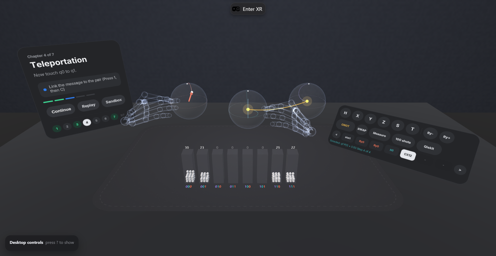

A translucent **ghost hand** plays each move on the orb it applies to when a step
starts, then steps aside, and comes back if you stall. Its poses are run through
the real gesture tracker in the tests, so it never demonstrates a move the app
would not recognise.

Every gesture has a poke button on the gate dock and a desktop key, so nothing
depends on a single input path.

| Gesture | Quantum action | Dock button | Desktop key |
| --- | --- | --- | --- |
| Pinch an orb and move | Pick up and place a qubit | – | click to select |
| Turn your wrist while holding | Continuous rotation (Ry), with a glowing trail | Ry- / Ry+ | hold ← → |
| Open hand, fingers spread, palm toward an orb | Hadamard (superposition) | H | H |
| Close your fist near an orb | Measure (collapse) | Measure | M |
| Touch two held orbs together | CNOT (entangle); a gold thread appears | CNOT | C |
| – | Pauli and phase gates | X Y Z S T | X Y Z S T |
| – | 100 shots: probability rain | 100 shots | Space |
| Tap a step on the timeline | Rewind or replay to that step | < start … > | Ctrl+Z / Ctrl+Y |
| – | Show the circuit as Qiskit code | Qiskit | – |
| – | The chapter card's own button (Oracle, Storm …) | blue card button | Enter |
| – | Previous / next chapter, lesson or sandbox circuit | navigator panel | [ ] |
| – | Course: everything, in order, with quizzes | navigator: Course | A (1 2 3 answer, J = Show me) |
| – | Learn mode | navigator: Learn | L |
| – | SWAP the selected qubit with the next | SWAP | W |
| – | Puzzles | navigator: Puzzles | Q |
| – | Build: circuit builder | navigator: Build | B (then arrows + letters) |
| – | Notes: read (or listen to) the explanation | Notes on the card | I |
| – | Copy a share link to this circuit | Qiskit, then Copy link | – |
| – | Code window: Qiskit, OpenQASM 3 or PennyLane tabs | Qiskit, then a tab | K, then G |
| – | Zoom the code window and notes (bigger, at eye level) | Zoom | = |
| – | Page through long code | Back / More | Up / Down |
| – | Route onto the 5-qubit chip and run with hardware errors | Qiskit, On chip, Run on chip | K, G to On chip, O |
| – | Pick the machine: superconducting chip, trapped ions, neutral atoms; compare all three | On chip: Chip / Ions / Atoms, Compare | voice: "trapped ions", "compare the machines" |
| – | Stand the machine at its real size beside the desk, or put it back | On chip: Full size | voice: "full size", "back on the desk" |
| – | The maths of each step: matrix, formula, state vectors | Qiskit, Maths | K, G to Maths, then Ctrl+Z / Ctrl+Y |
| – | Run on a real IBM quantum computer | Qiskit, On chip, Run on IBM | Shift+O on the On chip tab |
| – | Noise lab: T1, T2, gate error, zero-noise extrapolation | sandbox card: Noise | E (Shift+E on/off, Shift+M mitigate) |
| – | Library: save, load, import, QR code, custom gates | sandbox card: Library | F (Shift+F save, U tab, Shift+Y use, Shift+K QR, Shift+U import) |
| – | Simplify the circuit (Undo brings it back) | Qiskit, then Simplify | O |
| – | Step debugger: step, run to a breakpoint, see why each step changed the state | Debug | Shift+D (, . step, ; run, ' breakpoint) |
| – | Big-state views: Q-sphere, state city, entanglement map, circuit unitary | View | Shift+V |
| – | Voice commands | Voice | V |
| – | Shared lab or classroom: start, join, claim a qubit | Share | \ (and \| for the class panel) |
| – | Today's daily challenge | Puzzles tab, Daily | Shift+Q |
| – | Your progress: level, streak, achievements | navigator footer (Level) | Shift+P |
| – | Listen to the state as a chord | Listen | Shift+L |
| – | Save a picture of the circuit with a QR code | Share dialog | Shift+I |

Gesture thresholds live in `src/gestures/config.ts` (with hysteresis, hold times
and a shared cooldown, so fist, spread and pinch never trigger each other).

### Gates you can see

When a gate starts, the orb draws the exact circle the arrow tip is about to
travel (the gate's rotation axis and angle, starting from the current state) with
an arrowhead, so every single-qubit gate reads as what it is: a rotation. The
gate's name ("H", "Ry +45°") rises out of the orb; two-qubit gates send a gold
spark from control to target; a measurement shows "M = 1". A wrist turn is shown
live by the hand and is not replayed when it is released.

### Circuit board

A board at the back of the desk shows the circuit so far as a standard diagram
(gate boxes in each qubit's colour, gold CNOT dots and targets, faded steps after
a rewind, a blue cursor) and the full state as circles: the filled area is a
basis state's probability, the hand is its phase.

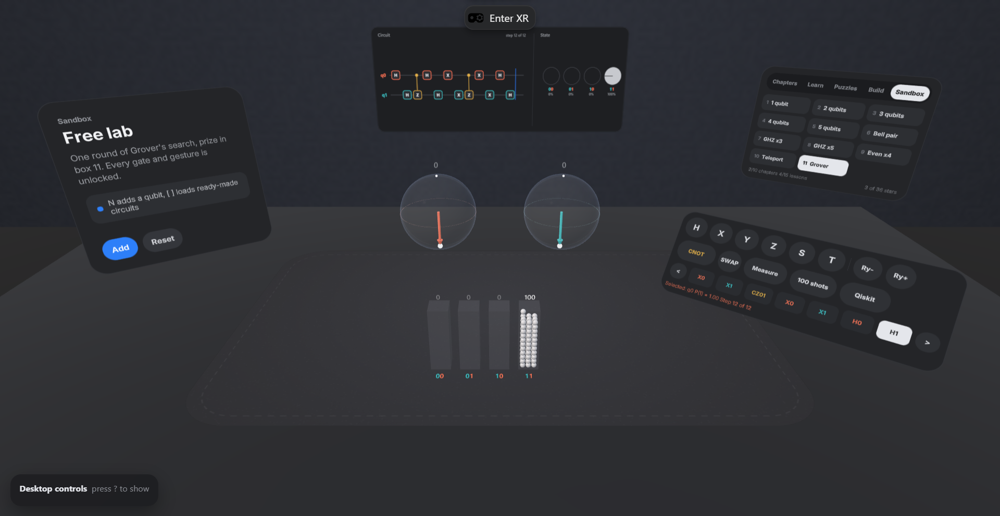

### Sandbox

Up to 5 qubits, every gate unlocked, plus ready-made circuits: Bell pair, GHZ
(3 and 5 qubits), an even superposition of 16 outcomes, a finished
teleportation to scrub through, and one round of Grover's search.

| Bell pair: 100 shots, only 00 and 11 | GHZ x5: five qubits, one shared coin |
| --- | --- |
| 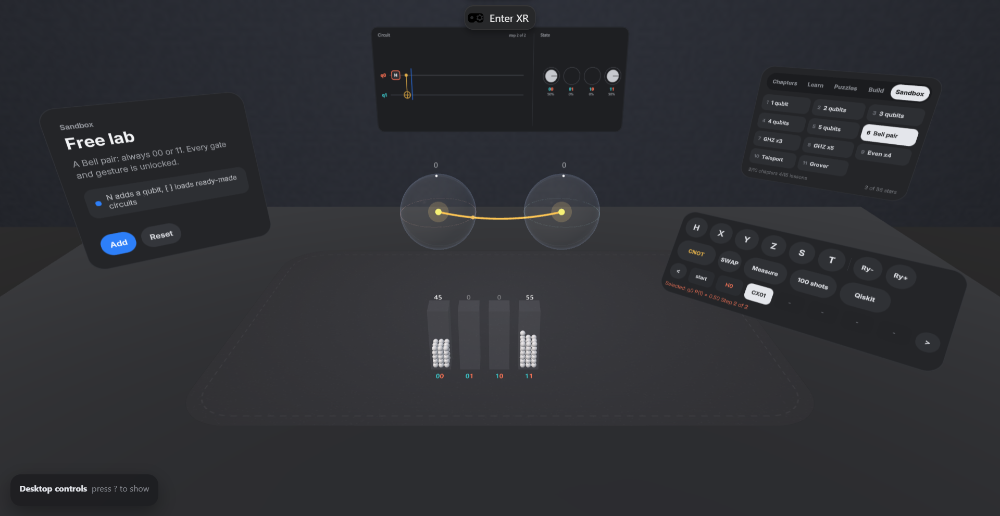 | 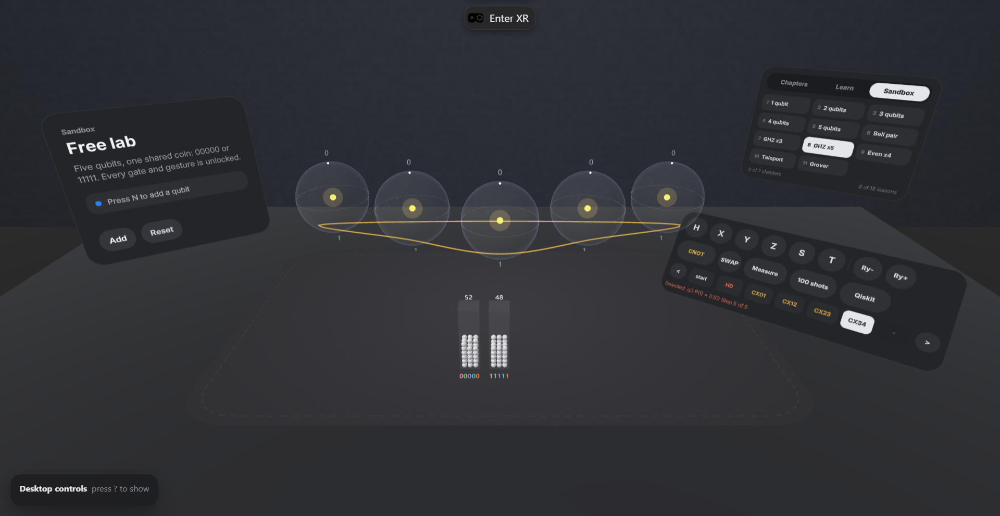 |

Each qubit keeps one colour everywhere (arrow, trail, desk label, timeline step,
outcome digit). Gold is reserved for entanglement: threads, cores, the GHZ ring
and multi-qubit gates on the timeline.

### Share links

The Qiskit panel has **Copy link**: a short, readable link such as
`#c=3_h0/x1c0/x2c1/M0=1` that opens the circuit, recorded measurement outcomes
included, in anyone's sandbox. Links are validated before anything is loaded.

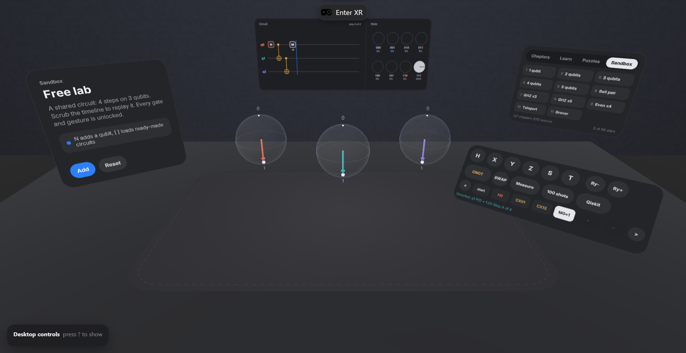

## Part 2: Learn, from the first qubit to research topics

### Course

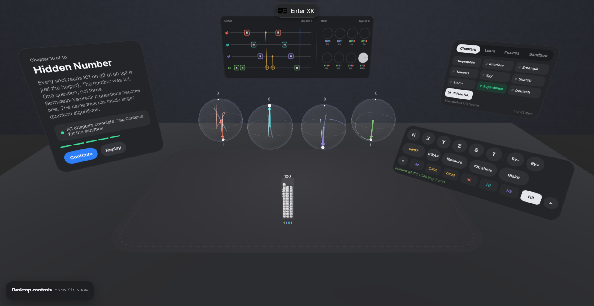

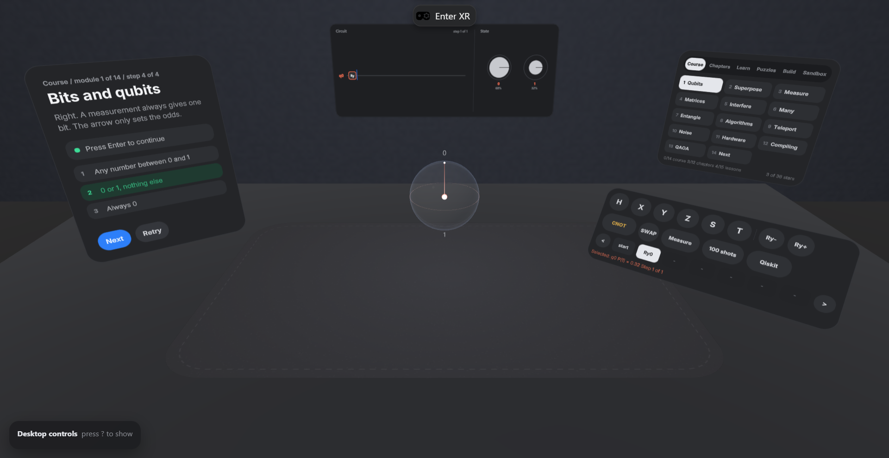

The **Course** tab teaches everything, in order, in 14 modules: bits and
qubits, superposition, measurement, gates as matrices, phase and interference,
many qubits, entanglement, algorithms, teleportation, noise and errors, quantum
hardware, compiling, variational algorithms (QAOA), and what next. Each module
mixes three kinds of step:

- **pages**: a short explanation, often with a live demo on the orbs while the
  board shows the matrices, or (in the hardware module) the chip, the fridge and
  the pulse schedule;
- **tasks**: do it yourself with the gestures, or tap **Show me** and watch it done;
- **quizzes**: three answers on the card; a wrong one turns red and you try
  again, the right one turns mint and explains why.

Progress is saved per module. The tests play the whole course start to finish
the way a learner would, and check that a wrong answer waits.


1. **Superposition** – turn a qubit with your wrist, split it with an open hand, collapse it with a fist.
2. **Interference** – split twice and it comes back to 0, 100 times out of 100.
3. **Entanglement** – two arrows vanish into one shared state; the results always match.
4. **Teleportation** – move your own quantum state to another qubit with one Bell pair and two bits.
5. **Quantum Spy** – BB84: Eve's look leaves errors; 400 photons show 0% without a spy and about 25% with one.
6. **The Search** – Grover: an oracle hides the prize in a phase, one amplification finds it 100 times out of 100.
7. **The Storm** – a lightning strike flips a random qubit; a 3-qubit code finds and repairs it without looking at the message.
8. **Two Bits, One Qubit** – superdense coding: a random two-bit message travels on one qubit of a shared pair, 100 shots out of 100.
9. **One Question** – Deutsch: a sealed box is constant or balanced; one question through phase kickback tells which, for all four boxes.
10. **Hidden Number** – Bernstein-Vazirani on 4 qubits: a random 3-bit number read in one question instead of three.
11. **The Mystery Qubit** – state tomography: a sealed box hides a random state; look at 100 copies along Z, X and Y, rebuild the arrow with your wrist and T, then reveal how close you came.
12. **Max Cut** – QAOA: optimise a variational circuit's two dials on the cost landscape, then two layers, and watch the best cuts dominate the shots.
13. **Phase Wheel** – the quantum Fourier transform turns the number 5 into angles you can see on phase wheels, and back.
14. **Phase Estimation** – phase kickback and an inverse QFT read a gate's secret angle in binary.
15. **Factoring 15** – Shor's algorithm (compiled): the period of 7^x mod 15 is 4, so 15 = 3 x 5.
16. **The H2 Molecule** – VQE on a real chemistry Hamiltonian: Hartree-Fock, then the exact ground energy, then the whole bond curve.
17. **Search 8 Boxes** – Grover on three qubits: two rounds, 94.5%.
18. **Simon's Secret** – the first exponential quantum speedup: the readings name a hidden bit string.

| Chapter 3: measure one qubit and the other always agrees | Chapter 8: two bits sent on one qubit, 100 of 100 shots |
| --- | --- |
| 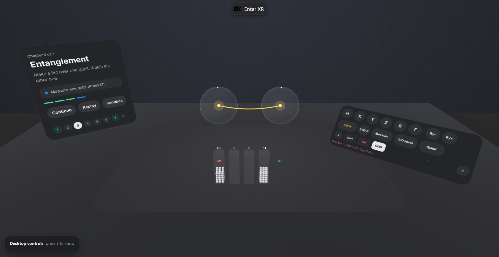 | 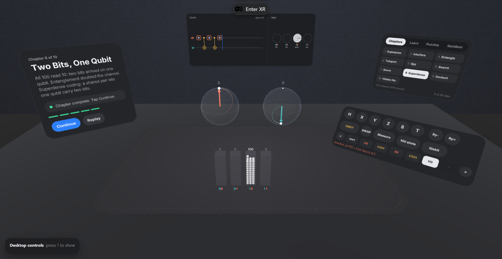 |

### Learn

| Z gate: the target ring turns mint | Kickback: the control flips, the target stays put |
| --- | --- |
| 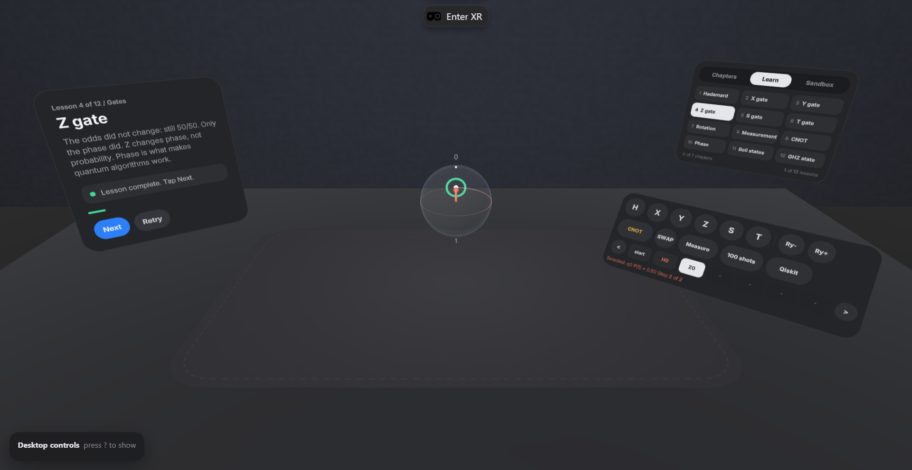 | 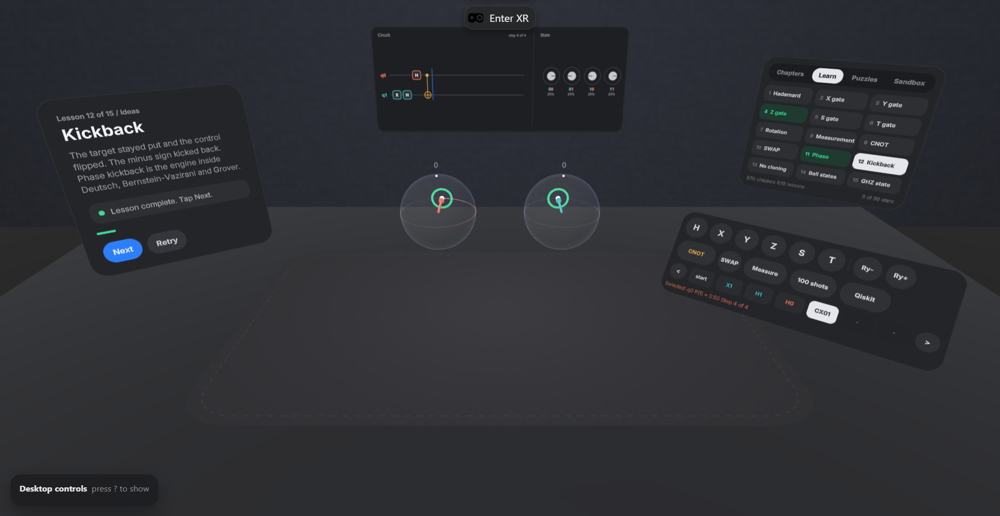 |

Fifteen short lessons, one per gate or idea: H, X, Y, Z, S, T, rotation,
measurement, CNOT, SWAP, phase, kickback, no cloning, Bell states and GHZ states. Each lesson explains the
gate in two sentences and sets one challenge. A faint **target arrow** and ring
inside the orb show where the state should end up; the ring turns mint when you
reach it. Lessons are tracked separately from chapters, and every lesson has a
scripted solution in the tests.

The **navigator** panel (upper right) switches between Chapters, Learn and the
Sandbox, and shows what you have finished.

### Qubiting: five new lessons

A new shelf on the Learn tab, built around the new tools: **Interference** (H
twice: the two paths to |1> cancel; open the Many worlds view to watch),
**Minus state** (the back of the equator), **The +i state** (the third axis),
**Phi minus** (a Bell pair with a hidden sign) and **All at once** (three Hs,
all eight answers). Each has notes and is solved end to end in the tests.

### Notes

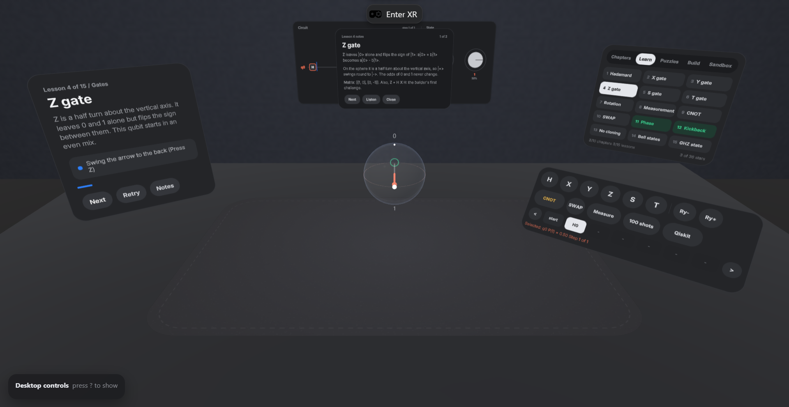

Every chapter, every lesson and the builder has **Notes**: three to five short
paragraphs in plain English that explain the idea behind it, the math in simple
form (|0>, sqrt(2), matrices), the Qiskit call, and where it is used in the real
world, ending with one highlighted key idea. The card's Notes button opens them a
page at a time; **Listen** reads the page aloud with the browser's speech engine,
so nothing has to be read in the headset. All notes text is checked in the tests
to be plain ASCII (the panel font has no special symbols) and to fit the panel.

### The Mystery Qubit

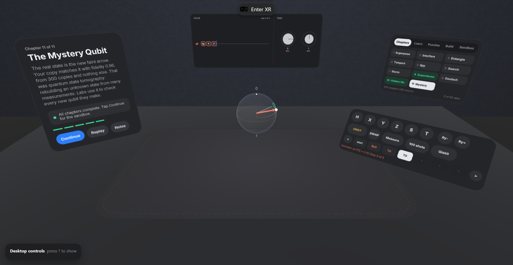

One copy of an unknown qubit tells you one bit. The box makes copies, so you
look at 100 of them along each axis (a Hadamard first for X, S dagger and H for
Y) and the counts land on the rain. Your estimate appears as a faint arrow; you
rebuild it on your own qubit with a wrist turn and T gates (45 degree steps
around the vertical axis), then Reveal draws the real state and the fidelity.
With 100 copies per axis it lands within about 0.1 of the truth, which the tests
check across 30 random states.

### QAOA: a variational algorithm

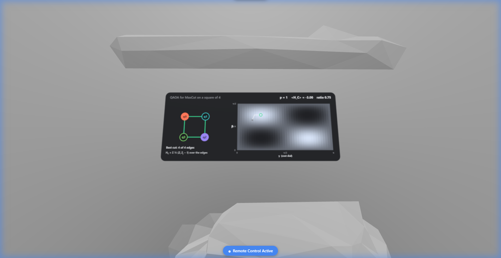

Chapter 12 and the course's QAOA module solve **MaxCut** on a ring of four
qubits: split the nodes into two teams so every edge crosses. The cost
Hamiltonian is H_C = sum of 1/2 (Z_i Z_j - 1) over the edges (PennyLane's
convention), so each split's energy is minus the edges it cuts. The QAOA
circuit (Hadamards, then per layer CNOT, Rz(gamma), CNOT on every edge and
Rx(2 beta) on every qubit) runs on the orbs; **Optimize** walks gradient
descent across the landscape, which the board draws over both dials with the
optimiser's path; the card reports <H_C> and the approximation ratio
<H_C> / min(H_C). One layer reaches the known 0.75 on a ring; **Deeper** adds a
second layer for more. The shots then favour 0101 and 1010, the best cuts.

The **PennyLane** tab exports the run as a program in the usual exercise shape
(`cost_hamiltonian`, `qaoa_circuit` with `qml.qaoa.cost_layer` and
`mixer_layer`, `qaoa_expval`, `qaoa_probs`, `approximation_ratio`) with the
parameters found. Run with PennyLane 0.42 it prints exactly the same <H_C> and
ratio as the app: -3.000 / 0.750 for one layer on the ring, -3.4573 / 0.8643
for two layers on a kite.

### Algorithm chapters

| QFT phase wheels | VQE for H2 |
| --- | --- |
| 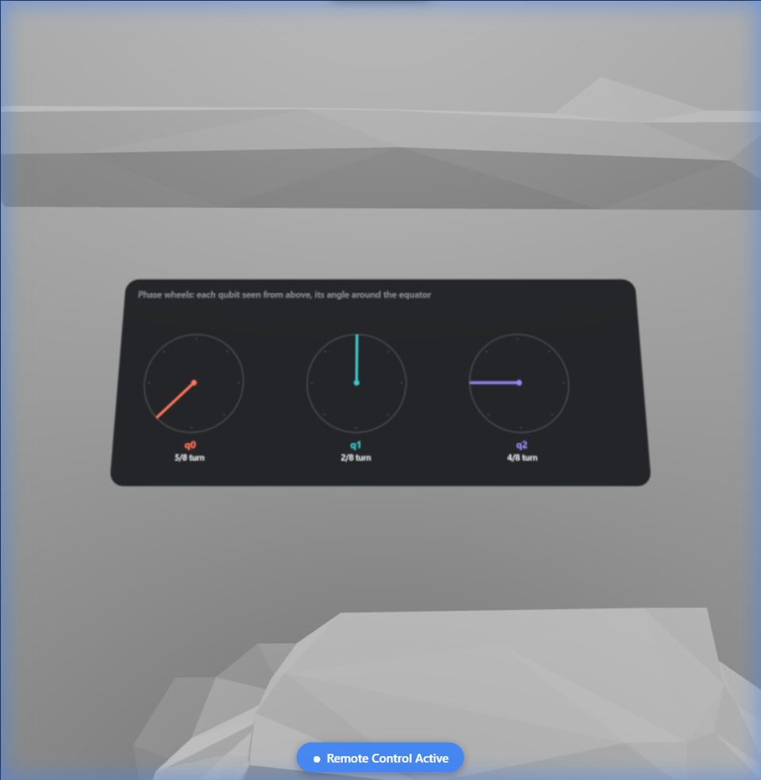 | 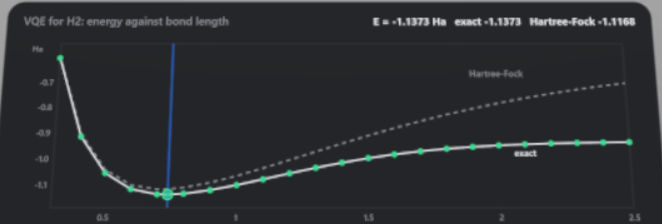 |

Chapters 13-18 add the QFT (phase wheels on the board), phase estimation, Shor
factoring 15 (a compiled modular exponent, said so on the card), VQE for the H2
molecule, Grover on eight boxes and Simon's algorithm. The H2 Hamiltonians are
real: generated with PennyLane's quantum chemistry (STO-3G, Jordan-Wigner, 4
qubits) by `scripts/gen-h2.py`; VQE reaches the exact ground energy at all 24
bond lengths, and the minimum sits at 0.74 Angstrom. Tests check the QFT
against the discrete Fourier transform, phase estimation for every k/8, Shor's
period and factors, Grover's 94.5%, and Simon's secret.

### Advanced chapters

Chapters 19 to 26 go past textbook algorithms into the physics that real
quantum computers are built and judged on (the last, the surface code, has its
own section below). Each one draws its own figure on the
board while you play, and each is played through end to end in the unit tests
with the numbers checked.

| Bell Test (CHSH) | Error Correction |
| --- | --- |
|  | 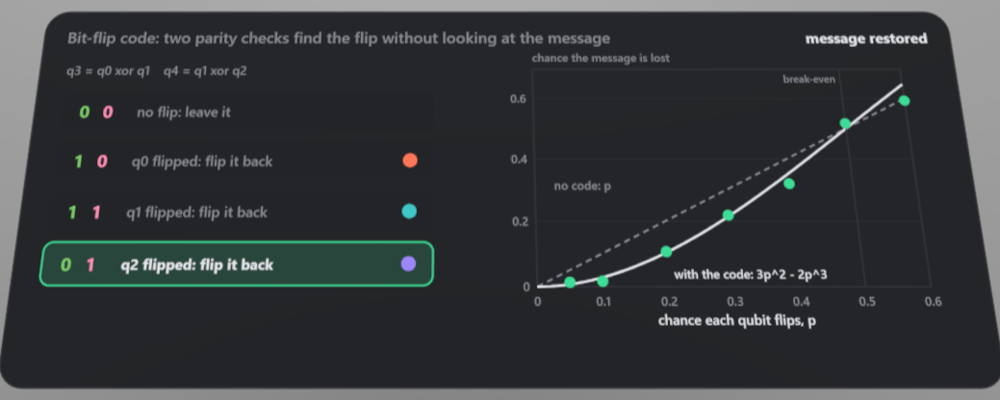 |

- **Bell Test**: Alice and Bob play the CHSH game. With a Bell pair they win
  about 85% of 1000 rounds (S near 2 sqrt 2, shown with its sampling error);
  after you measure one qubit they fall back under the 75% any advance plan can
  reach. Tests check S = 2 sqrt 2 exactly, that no product state passes 2, and
  that the quoted error matches the real spread over 400 games.
- **Error Correction**: tilt a message onto q0, spread it into
  a|000> + b|111>, let a storm flip one qubit, read two parity checks on the
  ancillas, correct, and decode: q0 points where you left it. Stress test runs
  the code 300 times at seven noise levels against 3p^2 - 2p^3.

| Entanglement Swapping | Quantum Walk |
| --- | --- |
| 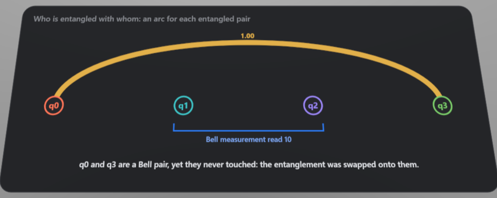 | 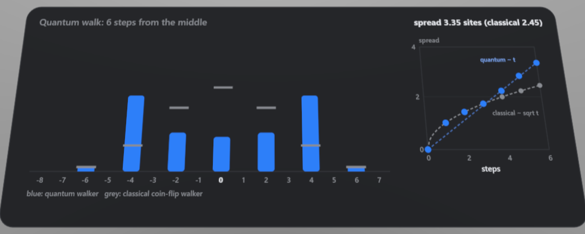 |

- **Entanglement Swapping**: two Bell pairs, a Bell measurement on the middle
  two, two classical bits sent, and q0 and q3 are entangled without ever
  touching. Every 100-shot run agrees on q0 and q3.
- **Quantum Walk**: a walker on 16 sites with a qubit coin (5 qubits, multi-
  controlled increments). After six steps it is most likely far from the start:
  a spread of 3.35 sites against 2.45 for a coin-flipping walker. Tests compare
  the circuit with an independent textbook walk to 12 decimals.

| Time Evolution (Trotter) | Quantum Zeno |
| --- | --- |
| 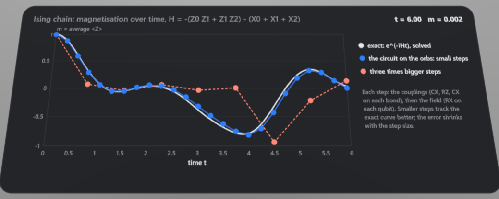 | 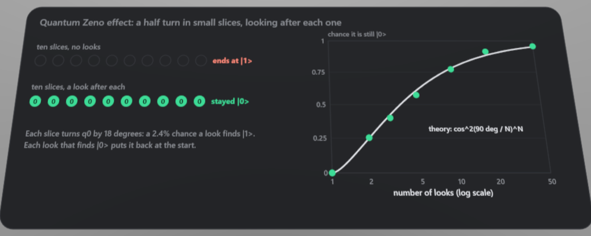 |

- **Time Evolution**: three spins with ZZ couplings and a transverse field,
  simulated in Trotter steps (CX, RZ, CX per bond, RX per qubit) right on the
  orbs. The exact curve comes from diagonalising the Hamiltonian; small steps
  follow its swing down to -0.8 and back, three-times-bigger steps miss it.
- **Quantum Zeno**: a half turn in ten slices reaches |1>; the same slices with
  a look after each one usually never leave |0>. Trying 1 to 50 looks traces
  cos^2(90 deg / N)^N.

| Benchmarking |
| --- |
| 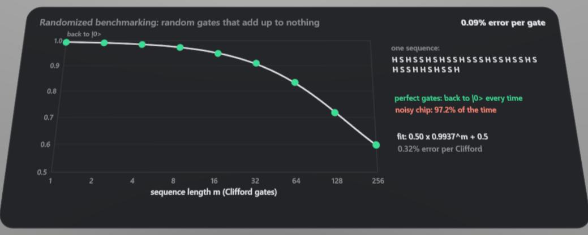 |

- **Benchmarking**: randomized benchmarking on the noisy chip model (T1, T2,
  gate error). Random Clifford sequences that undo themselves return to |0>
  exactly with perfect gates; on the noisy model, survival decays and the fit
  gives the error per gate. Tests check the 24-element Clifford group, an exact
  formula under depolarizing noise, and that the fit recovers the error it was
  given.

### The surface code

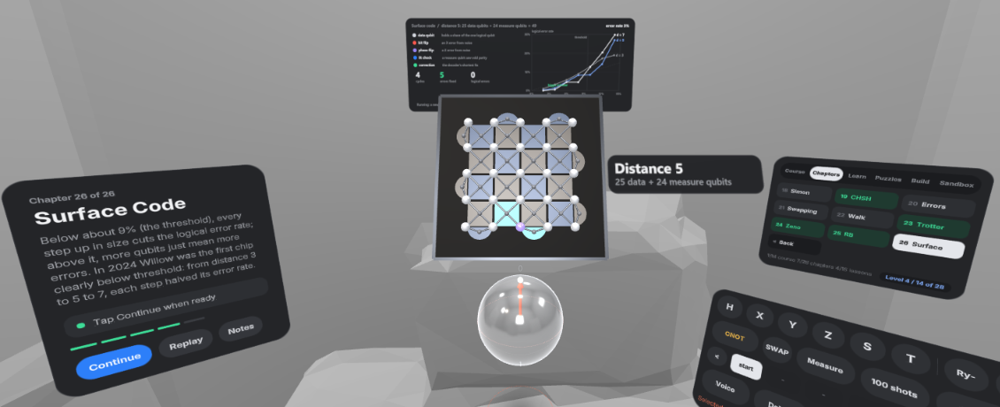

Chapter 26 runs the error correction Google demonstrated on its Willow chip in
2024. A chip floats above the desk: a grid of data qubits (silver beads) and a
measure qubit on every tile between them, wired by couplers, with half-discs
along the edges. The single orb on the desk is now the logical qubit they hold
together.

- **Cycle**: noise flips a few qubits (coral for a bit flip, violet for a phase
  flip), a sweep runs over the measure qubits, and the tiles around each error
  light up blue. That pattern, the syndrome, says where errors are and nothing
  about the logical state, so the orb does not move.
- **Decode**: a minimum-weight matching decoder pairs the lit tiles along the
  shortest paths, and the fixes grow in mint before the errors heal. If the
  real errors and the fix together stretch across the grid, the frame flashes
  coral and the orb really flips: a logical error.
- **Grow**: distance 5, 25 data and 24 measure qubits, now cycling by itself
  with live counters for cycles, errors fixed and logical errors.
- **Stress test**: thousands of cycles at each error rate for distance 3, 5
  and 7 draw the threshold plot: below about 9% every step up in size cuts the
  logical error rate, above it bigger is worse. **Storm** then pushes the noise
  to 12% and the orb starts to flip.

The decoder is exact minimum-weight matching (a bitmask search) for up to 16
lit checks. Tests check the lattice (d^2 - 1 checks, every pair of an X and a Z
check overlapping on an even number of qubits), that any single error and any
(d - 1)/2 errors are always corrected, that a chain across the grid is a
logical error with no syndrome, and that bigger codes win below threshold and
lose above it.

### The maths of every step

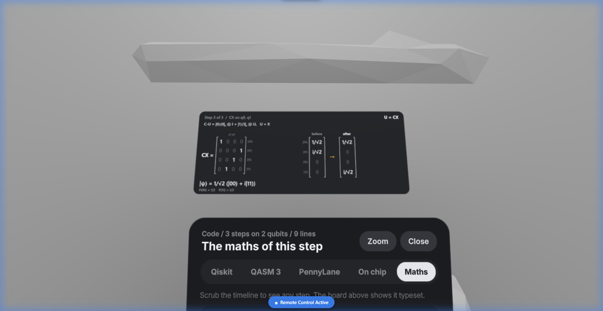

The code window's **Maths** tab turns the circuit board into a page of linear
algebra for the current step, and follows the timeline, so Ctrl+Z / Ctrl+Y (or
tapping a step) walks through the whole circuit one matrix at a time:

- **the gate as a matrix** on the qubits it touches (2x2, 4x4 for two-qubit
  gates, 8x8 for a Toffoli or Fredkin), rows labelled with kets in Qiskit's
  order, zeros dimmed, and a shared factor pulled out, so H reads
  1/√2 [[1, 1], [1, −1]];
- **its formula**: H = (X + Z)/√2, Ry(θ) = e^{−iθY/2} = cos(θ/2) I − i sin(θ/2) Y
  with the step's θ filled in, C-U = |0⟩⟨0| ⊗ I + |1⟩⟨1| ⊗ U, and for a
  measurement the projector P = |1⟩⟨1| with |ψ⟩ → P|ψ⟩ / ‖P|ψ⟩‖;
- **where it sits in the register** as a tensor product: U = I ⊗ H ⊗ I;
- **the state before and after** as column vectors (up to three qubits), and
  **the new state in Dirac notation** with the probability of each outcome.

Amplitudes are written exactly when they are simple (1/√2, i/2, √3/2,
e^{iπ/4}/√2) and as decimals otherwise. The panel shows the same in plain
text. Tests check the matrices (Qiskit qubit order, unitarity, the Toffoli
permutation, projectors), the exact forms and the Dirac strings.

## Part 3: Real quantum hardware

### On a real chip

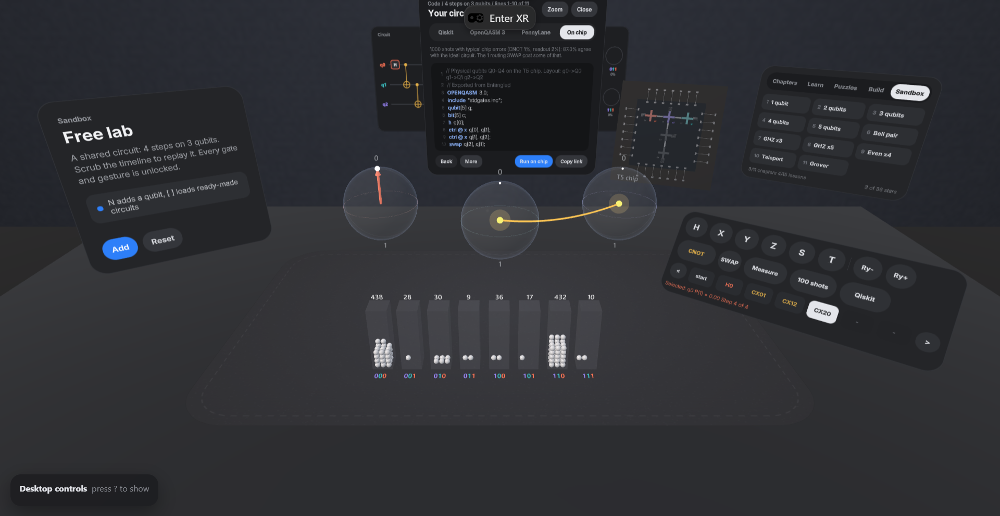

Real quantum chips only wire each qubit to its neighbours. The code window's
**On chip** tab maps your circuit onto **T5**, five superconducting qubits in a
T (the layout of many early cloud quantum computers), the way a compiler does:
gates with two controls are broken into one- and two-qubit gates (the textbook
Toffoli circuit, with Fredkin and CCZ built from it), every placement of your
qubits on the chip is tried, and SWAPs are added wherever a two-qubit gate's
qubits are not neighbours. A SWAP in your own circuit costs nothing: the
compiler just relabels which physical qubit holds which logical one. The tab
shows the routed OpenQASM on physical qubits Q0 to Q4 and what routing cost
("1 SWAP added: 3 two-qubit gates became 6").

**Run on chip** runs 1000 shots with typical hardware errors (1% per CNOT, 0.1%
per single-qubit gate, 2% readout), rains the counts on the desk and says how
far they are from the ideal circuit. A lit 3D model of the chip floats beside
the board: a silicon die with aluminium cross-shaped qubits, couplers, readout
resonators and wire bonds. Each qubit is tinted with the colour of the logical
qubit it holds, the run plays back on it, couplers flash gold for entangling
gates, and routing SWAPs visibly move the colours from qubit to qubit.

The tests check routing on 120 random circuits (every two-qubit gate lands on a
coupler, and the routed circuit is the same unitary through the start and end
layouts), the decompositions, and that the noise model behaves: no noise
matches the ideal, readout flips about 2%, and SWAPs cost fidelity.

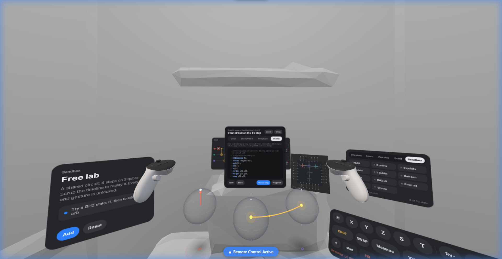

#### Inside the machine

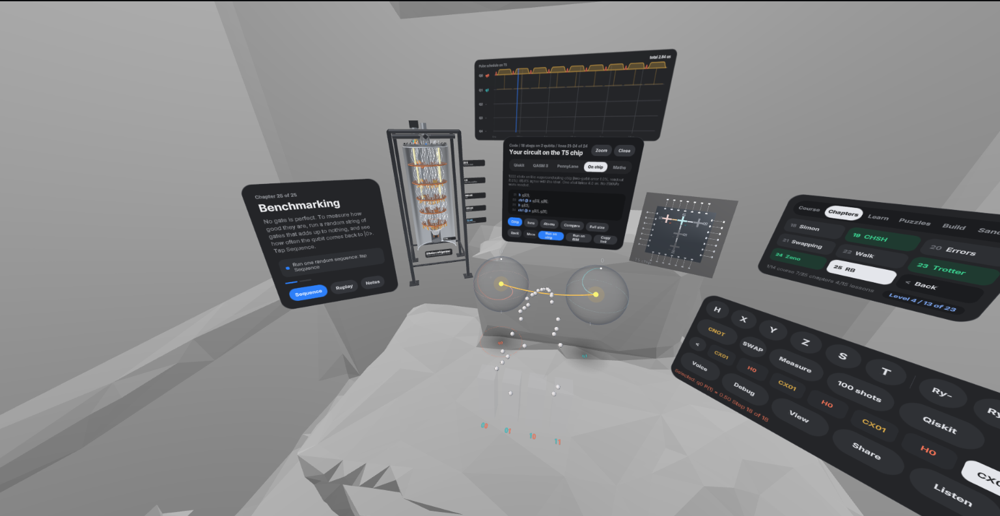

On the chip tab the rest of the machine appears. A **dilution refrigerator**
stands at the back left, modelled at real size and shown scaled down on the
desk: the copper "chandelier" a superconducting chip lives in. Five plates step
down from 50 K to 15 mK, hung from a steel top flange on fibreglass standoffs.
The pulse-tube cooler and the still's pumping line come down the middle, a
heat-exchanger coil feeds the mixing chamber, and 24 semi-rigid coaxial lines
loop their way down through attenuators, circulators and amplifiers to the chip
in its magnetic shield. Each time it comes into view its vacuum cans close and
slide away, and the stage thermometers cool down from room temperature. A
status light on the top flange is blue when ready and mint when a run
finishes. During a run each drive pulse travels down its qubit's line as a
glowing bead in that qubit's colour, two-qubit pulses go down in gold, and a
readout tone goes down one line and comes back up the amplified one in white.

The circuit board rises above the code window and shows the **pulse
schedule**: what the routed circuit looks like to the control electronics. One
line per physical qubit; single-qubit gates are 36 ns Gaussian pulses whose
height is the rotation angle; Z, S, T and other Z rotations take no time at all
(the electronics just shift the phase of later pulses, so they are drawn as
ticks); two-qubit gates are 280 ns cross-resonance pulses in gold; a SWAP is
three of them; readout is a 1.2 us tone. Gates start as early as their qubits
are free, so the timeline shows real parallelism and how much time routing
SWAPs add. A blue cursor sweeps across it while the run plays.

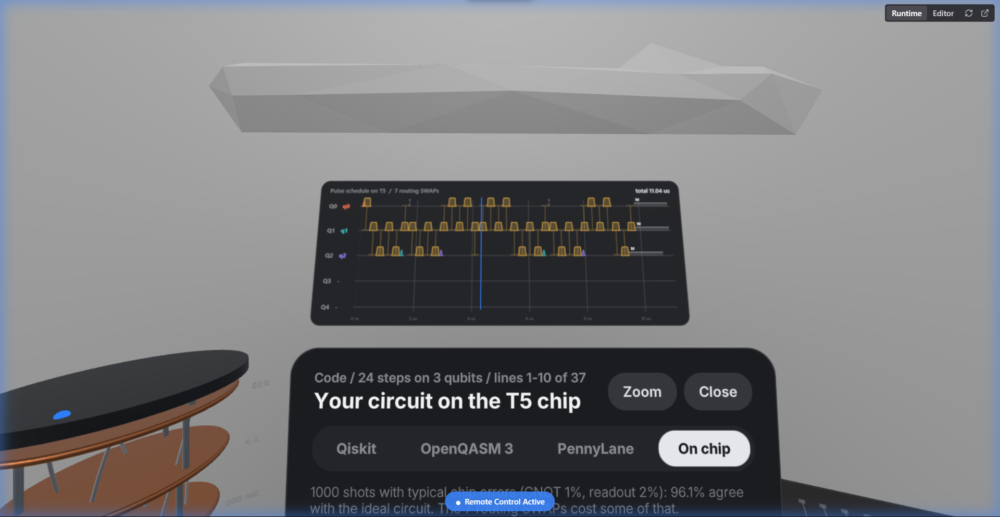

Windows now settle into place when they open, and Zoom glides between sizes
instead of jumping.

#### Three kinds of quantum computer

| Trapped ions | Neutral atoms |
| --- | --- |
| 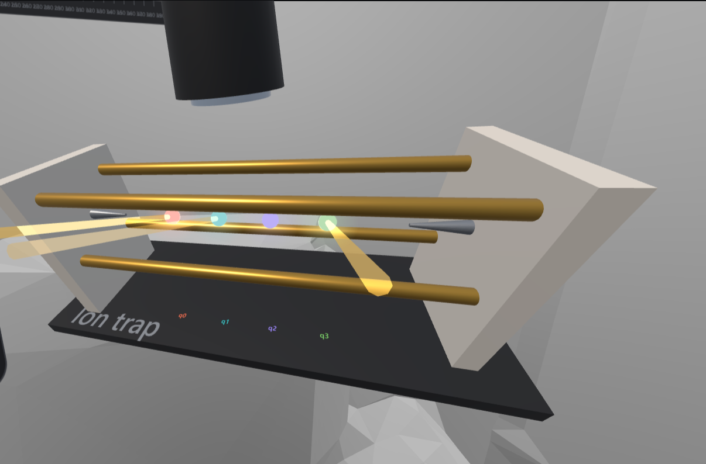 | 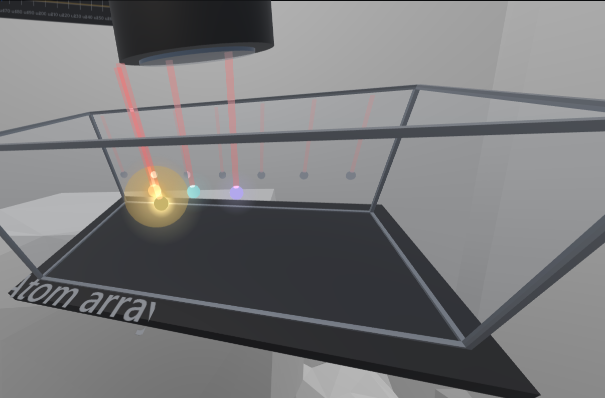 |

The chip tab now has a row for the machine: **Chip**, **Ions** or **Atoms**
(or say "trapped ions", "neutral atoms"). Each one compiles and runs your
circuit its own way, with its own 3D model where the chip floats and its own
surroundings where the fridge stands:

- **Trapped ions** (Quantinuum, IonQ): a linear Paul trap, four gold rods and
  two needle endcaps holding a chain of glowing ions, one per qubit, with the
  imaging lens above. Around it stands the vacuum chamber: viewports on every
  side, copper Helmholtz coils, an ion pump with its magnets, the RF resonator,
  and the objective and camera above. Coming into view, its lasers switch on one
  at a time (violet cooling, red repump, the Raman pair for gates) and the ion
  chain lights up behind the window. During a run a laser lights each ion a gate addresses; a two-qubit gate
  lights both in gold and sets the chain swaying, because the ions talk through
  their shared motion. Every ion reaches every other, so nothing is rerouted.
  Gates are slow (10 us and 200 us) but very accurate (0.3% two-qubit error).
- **Neutral atoms** (QuEra, Pasqal, Atom Computing): a glass cell under a
  microscope objective, a row of atoms each held in a red optical tweezer, and
  spare atoms waiting behind. On its optics table the tweezer laser runs through
  two crossed deflectors, a lens and a periscope into the objective; six cooling
  beams cross in the cell between two copper coils, and blue and red Rydberg
  lasers fire during gates. Coming into view it plays what a real machine does
  before every run: atoms fall into a 5 x 5 grid of tweezers at random, about
  half of them, and are then sorted one by one into a perfect block. Neighbours interact directly; for a gate between atoms further apart
  one atom is carried along the lane in front, the two glow gold while the
  Rydberg interaction entangles them, and it is carried back. Moving costs time
  and a little error; reading the atoms takes a camera exposure (about 10 ms).
- **Superconducting** (IBM, Google, Rigetti): the T5 chip and the fridge, as
  above.

The board shows each machine's pulse schedule with its own timings, so the
long gaps on the atom array are atoms moving.

**Compare** runs the same circuit 1,000 times on each machine and
puts the results side by side: every machine's outcomes against the ideal, how
closely it agrees, how long one shot takes and what its wiring cost (SWAPs,
atom moves, or nothing). Superconducting chips are fastest; ions are most
accurate; atoms are in between and can move qubits to where they are needed.
The error rates and timings are typical published figures, rounded; tests
check that every machine without noise gives the ideal answer, that all-to-all
wiring never needs SWAPs, and that atoms only move for gates between
non-neighbours.


#### Full size: walk around the machine


**Full size** on the chip tab (or say "full size") grows the machine around
the qubits from its desk model to its real size and stands it on the floor
beside the desk, turned to face you: a 2.4 m dilution refrigerator in its
frame, a vacuum chamber on an optical table, or a 1.2 m optics table on its
legs. Walk around it, lean in to read the thermometers, and run your circuit to
watch the pulses go down the lines at full scale. The fridge stands in a glass
display case with a black plinth and cap, the way IBM shows its Quantum System
One. "Back on the desk" shrinks it
again.

| Opening and cooling down | Inside, 50 K to 15 mK |
| --- | --- |
|  | 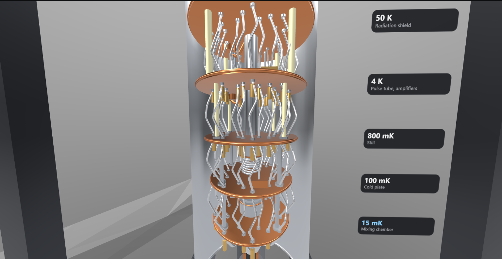 |
| **The ion trap's vacuum chamber** | **The atom array's optics table** |
| 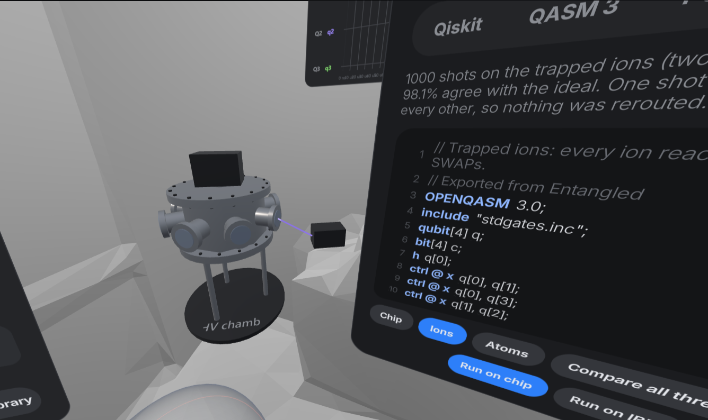 | 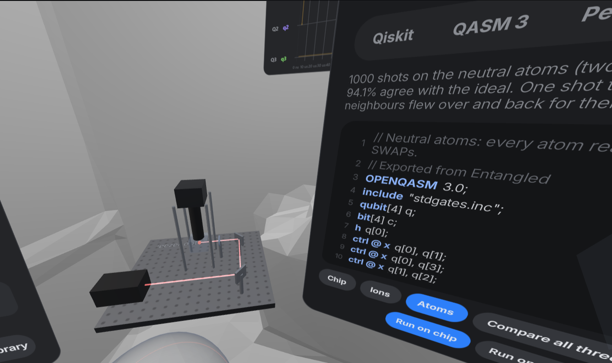 |

Every machine is built from merged parts (one mesh per material, a handful of
draw calls each) and lit by a soft studio environment so steel, copper and
glass read as real materials on the headset.

### Run on a real quantum computer

The code window's **On chip** tab has **Run on IBM**: your circuit runs on an
actual IBM Quantum computer through your own IBM Quantum Platform account (the
free Open Plan works). Add your API key and instance CRN once on the 2D page
(the **IBM Quantum** button at the bottom right; they stay in this browser).
The app then does what Qiskit's transpiler does at its simplest:

- picks the least busy operational backend with CZ gates (IBM Heron), reads its
  wiring and calibration, and chooses a connected group of good qubits;
- routes the circuit onto them, adding SWAPs where qubits are not wired;
- rewrites every gate in the chip's native set: one-qubit gates become
  RZ SX RZ SX RZ from their Euler angles, controlled gates become CNOTs and
  one-qubit gates, and each CNOT is a CZ between Hadamards;
- submits a 1000-shot Sampler job as OpenQASM 3 on the physical qubits, polls it
  (it survives a reload), and rains the real counts on the desk next to how
  close they are to the ideal circuit and to the noise model's prediction.

Tests check the native translation (same unitary for every gate), compiling 40
random circuits onto a heavy-hex fragment (native gates only, wired pairs only,
same result through the layouts), Qiskit parsing the output as RZ/SX/CZ only,
and the client's requests against a scripted stand-in for IBM's API (paths,
`Service-CRN`, `IBM-API-Version: 2026-04-15`, the Sampler body). Through the dev
server's proxy, IBM's live login and API both answer a fake key with the
right rejection. A real hardware run needs your key, so it is the one step
not run here; queues on the free plan can take minutes.

Browsers cannot call IBM's servers directly (CORS), so `vite.config.ts`
forwards `/ibm-iam`, `/ibm-api` and `/ibm-api-eu`; a hosted build needs the
same three forwards.

### Noise lab

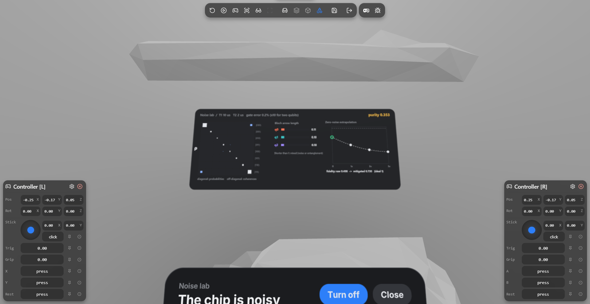

In the sandbox, **Noise** (or E) opens the noise lab. Turn it on and every gate
runs as on a real chip: depolarizing error (ten times more for two-qubit gates),
**T1** energy loss and **T2** dephasing during each gate's duration (36 ns, 280
ns, 1.2 us readout). The orbs show the mixed state, so arrows shrink inside the
spheres; shots sample it; and the board shows the **density matrix** (square
size = |rho_ij|, probabilities on the diagonal, coherences off it), each qubit's
Bloch length and the purity. **Mitigate** runs **zero-noise extrapolation**: the
fidelity with the ideal state at 1x, 2x and 3x the noise, fitted back to zero.

The density-matrix simulator matches the statevector exactly without noise,
gives e^(-t/T1) decay and T2 dephasing, and matches Qiskit's `quantum_info`
density matrices with the same channels to 3e-16.

## Part 4: Tools for exploring

### Build: circuit builder

| Challenge 10: a Fredkin from a Toffoli and two CNOTs | Free build: every tool, the orbs run it live |
| --- | --- |
| 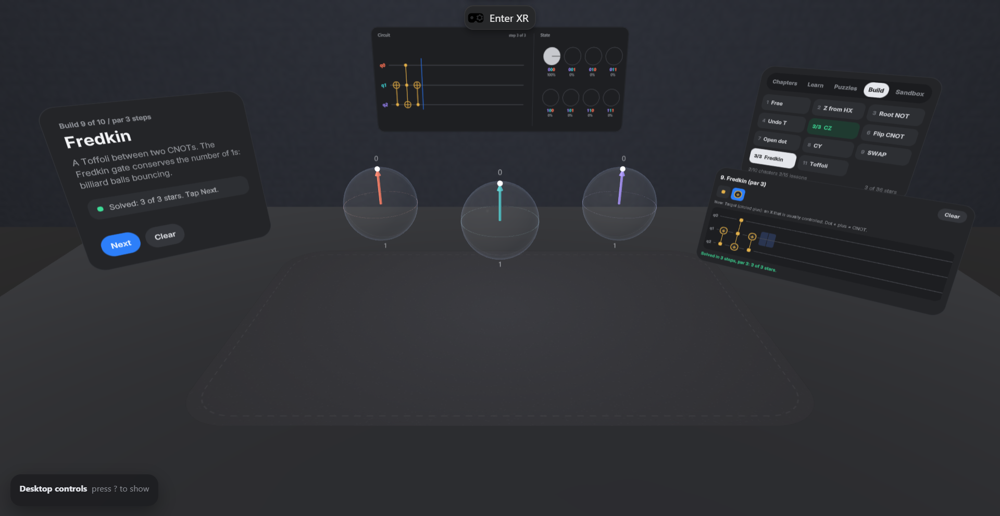 |  |

A fifth tab turns the gate dock into a grid editor written in standard circuit
notation: filled dots (controls), open dots (anti-controls), circled-plus targets
and swap marks. Dots control every gate in their column, so a dot over a plus is a
CNOT, two dots a Toffoli, a dot with two swap marks a Fredkin. Every edit runs on
the orbs, the circuit board and the timeline immediately.

Ten tools are new beyond the dock: S dagger, T dagger, square root of X and its
dagger, Rx, Rz, control, anti-control, target and swap.

Ten challenges are checked as whole gates (the same output for every input, up to
one global phase), not just one state: Z from H and X, X from square roots of X,
T dagger from seven Ts, CZ from a CNOT, a reversed CNOT with dots only on q0, an
open dot built from X, controlled-Y, SWAP from three CNOTs, a Fredkin from a
Toffoli, and (expert) a Toffoli from two-qubit gates, H, T and T dagger. Rules
block the easy way out, par is the reference solution's step count, and stars
work like puzzles. Desktop: arrows move a cursor; H X Y Z S T place gates (Shift
for the daggers), V is SX, 1 2 3 are Rx Ry Rz, C a dot, O an open dot, P a plus,
W a swap mark.

### Code window: tabs, zoom, simplify


The **Qiskit** button opens the code window: the whole program, not just the
gates, as **Qiskit**, **OpenQASM 3** (the text format IBM Quantum, Qiskit and
Amazon Braket read; any controlled gate is written exactly with `ctrl @`) or
**PennyLane**, one tab each. Lines are numbered with the gate or call name
picked out, ten to a page with Back and More, and a new step keeps you on the
last page. **Zoom** makes the window 1.3 times bigger and brings it to eye level
just above the orbs, where code is readable in a headset; Unzoom puts it back.
The Notes panel shares the same Zoom.


 **Simplify** shortens the circuit the way a
compiler's first passes do: gates that undo each other cancel (H H, S S dagger,
CNOT CNOT), gates that add up merge (T T is S, two SX are X, rotations add), and
gates slide past others they commute with so more of them meet, e.g. a Z on a
CNOT's control passes through it. Measurements and classically controlled gates
never move. In the sandbox the circuit is replaced and Undo brings yours back;
in a chapter the panel only previews the shorter version.

Both exports and the simplifier were cross-checked against Qiskit 2.5 (the QASM
loaded with `qiskit.qasm3.loads`, every circuit compared as a full unitary) on
60 random circuits with every gate, one and two controls, swaps and iSWAP. The
unit tests check the simplifier on 300 random circuits, and that every pair of
gates it calls commuting really does.

### Step debugger

| Stopped at a breakpoint | Stepping onto a measurement |
| --- | --- |
|  |  |

**Debug** on the dock (or Shift+D) opens a debugger for the circuit on the orbs.
Step back and forward one gate at a time, set **breakpoints** on timeline steps
(they get a coral border) and **Run** to the next one. For every step it shows
a live histogram of the outcomes at that point, and says in plain words **why the state
changed**: which amplitudes a gate mixed, when two qubits became entangled, and
when a measurement collapsed a partner too. When a pair stops being entangled
because the entanglement spread to a third qubit, it says that rather than
"no longer entangled".

### Big-state views

**View** (Shift+V, or say "next view") cycles five ways to see a state that is
too big for one Bloch sphere each, or the whole circuit at once.

#### Many worlds


The first view (or say "many worlds") draws every path the computation takes.
Time runs left to right, one row per basis state. Each gate sends a basis state
to a few others, each with a complex weight from its matrix; every one of those
moves is a strand, as thick as the weight it carries and coloured by its phase,
and every state that holds weight is a bead sized by its probability. Where
strands meet, their weights add as complex numbers: in phase they reinforce,
out of phase they cancel, and an empty ring marks a state that paths reached
but where nothing is left. That is destructive interference, the trick behind
every quantum speed-up, and here it is a thing you can point at: put H on a
qubit twice and the two paths to |1> wipe each other out. A measurement keeps
the worlds that agree with its outcome and ends the others in faded stubs. The
tree grows layer by layer whenever the circuit changes; tests check H H, a Bell
pair and a measurement path by path.


| Q-sphere | State city |
| --- | --- |
|  |  |

- **Q-sphere**: one dot per basis state with any weight. All 0s at the top, all
  1s at the bottom, states with the same number of 1s on one latitude. Dot size
  is probability, colour is phase relative to the largest amplitude (a colour
  wheel on the board).
- **State city**: the density matrix as two grids of towers, real and
  imaginary parts. Grey towers on the diagonal are probabilities, blue ones are
  coherences, coral ones hang below the plate when negative. With the noise lab
  on, you watch the blue towers shrink.
- **Entanglement map**: how strongly each pair is entangled (negativity) and
  how entangled each qubit is with all the rest, in gold, with a sentence
  underneath. A GHZ state shows weak pairs but every qubit fully entangled: the
  entanglement belongs to the whole group.

| Two Bell pairs | A four-qubit GHZ state |
| --- | --- |
|  |  |

- **Circuit unitary**: the circuit up to the timeline cursor as one 2^n x 2^n
  matrix. Each entry is a square: its size is the magnitude and its colour the
  phase, on the same colour wheel as the Q-sphere. Column k is what the circuit
  does to |k>. A sentence says what kind of matrix it is: the identity, only
  phases (diagonal), a permutation (a classical reversible circuit), partly
  mixing, or dense. After a measurement it explains why there is no single
  matrix any more. Unit tests check that every circuit gives a unitary matrix
  that acts like the circuit itself.


### Library, import and custom gates

- **Library** (sandbox card, or F): My circuits and My gates, saved on this
  device. The board shows them as thumbnails; Load opens a circuit.
- **Import** reads OpenQASM 2 or 3 and Qiskit code, pasted on the 2D page.
  Every exported program reads back as the same circuit (120 random round trips
  each), and QASM written by Qiskit itself imports exactly.
- **QR code** draws the current circuit's share link on the board; a phone
  camera opens it (checked by decoding the rendered code). Where the browser
  has a barcode detector and a camera, the import dialog can scan one too.
- **Make gate** turns the circuit on the orbs into one reusable block: tiles
  G1-G3 in Build (a dot in the column controls the whole block), or Apply in the
  sandbox onto the selected qubit and up.
- Builder rotations take any angle in steps of pi/8 (, and . on a keyboard),
  and the Maths tab shows every one-qubit gate's Euler angles,
  U = e^{i a} Rz(phi) Ry(theta) Rz(lambda), checked to rebuild 50 gates exactly.

### Voice commands


**Voice** on the dock (or V) listens through the browser's speech recogniser.
It is forgiving about how things are said, and every
command it hears is shown briefly so you know what it understood:

- gates: "Hadamard on qubit two", "X on zero", "S dagger", "rotate qubit zero
  by pi over four around x"
- "entangle zero and one", "CNOT from one to two", "swap one and two"
- "measure qubit one", "measure everything", "run a thousand shots"
- "undo", "redo", "reset", "add a qubit", "next", "show me", "answer two"
- "open the code", "simplify", "zoom", "noise", "library", "debug", "next view"
- rooms: "start a shared lab", "join L K seven Q F", "claim this qubit",
  "assign module three", "classroom", "leave the room"

The grammar is unit tested, including the words recognisers write for numbers
("to", "too", "for", "tree").

### Listen to a state

**Listen** on the dock (or Shift+L, or say "listen") plays the state as sound.
Every outcome with a real chance of turning up is a note, |00...0> lowest,
climbing a pentatonic scale, as loud as its amplitude. Its phase sets when it
sounds: equal phases ring together as a chord, different phases roll out as an
arpeggio. |0> is middle C; |+> is a chord of two notes; |-> plays the same two
notes 0.3 s apart; a Bell pair is two notes at once; after a measurement
there is only one. A global phase changes nothing, which the tests check.

### Snapshot

The share dialog's **Save picture** (or Shift+I, "take a picture") saves the
board as it is right now, with a title and a QR code of the link that opens
the same circuit, ready to post.


## Part 5: Together, and every day

### Code Lab: write your own programs


The **Code Lab** (first on the Play tab, the **Edit** button on the code window,
or say "code lab") is where you write your own programs. There is no keyboard
in a headset, so code is built from tokens: tap a gate (h, cx, rx, ccx,
measure ...), then its qubits, and an angle for rotations. Every statement
finishes itself, so what is on the panel is always real OpenQASM 3 you could
paste into Qiskit. **Run** plays the program on the orbs a gate at a time,
**Step** goes line by line, **From orbs** turns the circuit you made with your
hands into code, **Example** loads a Bell pair, GHZ, two-qubit Grover or a
tilt-and-twist, and **Link** copies a replay link: whoever opens it watches your
circuit play back, gate by gate. Unfinished lines show a _ where something is
missing, and Run points at the first one.

### Games that teach: spies, decoders, mazes and quests

| The spy game (BB84) | Be the decoder |
| --- | --- |
|  |  |
| **The Grover maze** | **Daily quests** |
|  |  |

- **Spy game (BB84)**: Alice sends Bob sixteen photons, each a random bit in a
  random basis; they fly along a fibre with their polarisation drawn on them,
  and Bob's readings stack up at his station. Eve is tapping the line half the
  time, at random. Alice and Bob keep the bits where their bases matched and
  compare half of them in public; you call it: was Eve listening? Without Eve
  every compared bit agrees; with her, about one in four is wrong, because she
  cannot copy a photon and half her guesses of basis disturb it. Tests check
  zero errors without Eve and 21 to 29% with her over 400 rounds.
- **Be the decoder**: bit flips hide on a surface-code lattice and only the
  checks they light are shown. Tap data qubits on the pad to flip them until
  every check is dark, ideally with as few flips as the computer's matching
  decoder; then Check reveals the real errors. If your fix and the errors
  together cross the grid, the logical qubit flipped. Win three and the code
  grows to distance 5.
- **Grover maze**: eight doors, one prize. Bars above the doors show their
  amplitudes; Oracle flips the prize door's bar below the line and Diffuse
  reflects every bar about the average, on the orbs with real gates (X, CCZ,
  H). After two rounds one look finds the prize 95% of the time; classically
  you would open four doors on average.
- **Daily quests**: three small tasks a day, the same for everyone, picked by
  the date from a pool of twelve (apply 30 gates, make two Bell pairs, score
  1,000 in Rush, run two programs in the Code Lab ...). Each pays 15 XP.
- **First five minutes**: a guided welcome tour, the first item on the Play tab
  after the Code Lab (and a Learn lesson): turn a qubit, H, measure, entangle,
  and 100 shots of your first Bell pair, with the ghost hand showing each move.

### The Play tab: ten wonders

The navigator's **Play** tab gathers the things to do just for fun. Each one
is a tap away (or say its name), and the switches stay on while you do
anything else.

| Quantum dice | Schrodinger's cat |
| --- | --- |
|  |  |
| **The penny flip you always win** | **The State Album** |
|  |  |

- **Quantum dice**: an eight-sided die tumbles while three qubits, each put
  half and half by an H, are measured; it lands on the number they give. The
  randomness is the Born rule on the orbs, not a pseudo-random generator.
- **Schrodinger's cat**: a wooden box on the desk. While the qubit is in
  superposition the cat is awake and asleep at once (tilt the orb to change
  the odds); measuring opens the lid on one or the other. A kinder cat.
- **Penny flip**: David Meyer's 1999 game. You move, the computer secretly
  flips the coin or not, you move again, and heads wins. Classically you win
  half the time; with H before and H after you win every time, because a flip
  does nothing to |+>.
- **State Album**: fifteen famous states, from |1> and |+> to the four Bell
  states and GHZ on five qubits. Make one on the orbs, any way you like, and it
  is collected with a banner and a burst of confetti; the board shows the
  album with hints for the empty slots.
- **Zen Rush**: Quantum Rush with no clock, for practising.
- **Giant sphere**: a Bloch sphere two metres across, centred over the desk so
  you sit inside it, its six poles labelled. The selected qubit's arrow reaches
  out from the middle and its tip paints a lasting trail: a circuit draws a
  picture around you.
- **Inside a qubit**: a transmon a thousand times bigger. The aluminium cross is
  the capacitor; a small loop at one arm holds two Josephson junctions, shown
  again blown up as two metal layers with a sliver of oxide between; a drive
  line and a readout resonator reach in. Beside it the energy well: the levels
  get closer as they climb, so a pulse tuned to 0-1 leaves |2> alone. The
  selected qubit's |0> and |1> fill their levels as you turn it.
- **Night sky**: the room gives way to a deep blue dome of stars with an aurora
  low on the horizon; the lab stays where it is.
- **History**: eight milestones in an arc around the desk, each a small turning
  model above its card: Feynman 1981, Deutsch 1985, Shor 1994, Grover 1996, the
  first two-qubit computers 1998, Sycamore 2019, logical qubits 2023 and Willow
  2024.
- **Ambient music**: every basis state with weight is a note of a pentatonic
  chord, as loud as its amplitude, with a slow tremolo and a long echo; gates
  glide the chord.


### Quantum Rush


An arcade round on two qubits, first on the navigator's new **Play** tab (or
say "quantum rush"). The Play tab also opens today's daily challenge, the
Surface Code chapter, and a many-worlds demo where paths cancel in front of you. A target state appears; make it on the orbs any way you like, and the
moment they match it scores and the next one appears. Targets climb from a
single gate to Bell pairs with phases, then to generated states three or four
moves deep, each with a true minimum par found by search.

- **Points**: 100 per par move, up to as much again for speed, times a combo
  that grows with every solve within 15 seconds of the last (up to x5).
- **The clock**: 60 seconds, shown as sixty ticks around the desk that go out
  one by one (coral for the last ten). Each solve adds 3 seconds; a skip costs
  3 and breaks the combo.
- **The board** shows the target's amplitudes beside the orbs' own, bar for
  bar, coloured by phase, so you can see what is still missing.
- Your best score and best combo are kept; the summary on the board shows your
  five best rounds, with this one highlighted. A new best (and every x4 combo)
  sets off a burst of confetti, and two achievements wait at 5,000 points and a
  x5 combo.

### Shared lab


**Share** opens a room. Everyone in a **shared lab** works on one circuit: a
gate anyone applies, an undo, a rewind or 100 shots shows up for everyone. Late
joiners catch up straight away. Two people can each **hold half of a Bell
pair**: select a qubit and press Share (or say "claim this qubit") and only you
can turn it; its desk label shows your name, and gates on someone else's qubit
are refused with a short note. A two-qubit gate is allowed when one of the
qubits is yours or free, so you can still entangle with a partner. Someone who
joins as a teacher can turn any qubit.

| The room on the 2D page | Someone else's qubit |
| --- | --- |
|  |  |

Rooms have a short code (`LK7QF`) and a link with a QR code, so a phone or a
second headset joins by scanning it. Edits that cross are settled the same way
on every device (newest version wins, ties by id), so everyone ends up with the
same circuit.

The relay is built into the dev and preview servers (`/entangled-relay`). For a
static deployment run it anywhere with Node:

```sh
node server/relay.mjs 8787      # then open the app with ?relay=wss://your-host:8787
```

Without a relay, tabs on the same device still share a room.

### Classroom and certificate

| The teacher's panel | A student who has finished |
| --- | --- |
|  |  |

**Start a class** makes the teacher's room (`C7QF2`). The teacher picks course
modules on the class panel and presses **Assign** (or says "assign module
two"). Each student's headset goes straight to the first assigned module they
have not finished, and reports their progress as they go. The panel lists every
student with a bar and where they are ("Module 2, step 3 of 5"), green once they
are done.

When a student finishes their assigned modules (or, on their own, the whole
course) the board shows a **certificate**, and the 2D page can save it as a PNG.


### Daily challenge, achievements and levels

| The daily challenge, solved | Your progress |
| --- | --- |
|  |  |

- **Daily challenge**: one puzzle a day, the same for everyone, at the end of
  the Puzzles tab (or Shift+Q, "daily challenge", or a `#daily` link). The date
  seeds a random circuit on two or three qubits, and a breadth-first search over
  every move the player has (H, X, Y, Z, S, T, CNOT, SWAP) finds the shortest
  way to make the same state, so par is the true minimum: tests check that no
  shorter sequence exists. Solving it extends a streak, and on the 2D page the
  result comes as one line to copy and paste: "Entangled daily #25: 2 moves
  (par 2), 3 of 3 stars. Streak: 1 day."
- **Achievements**: 34 of them, from "First move" and "Spooky action" (your
  first Bell pair) to "All for one" (a five-qubit GHZ state), "Rainmaker"
  (1,000 shots), "Beyond classical" (the Bell Test), "Below threshold" (the
  surface code), "Many worlds" (watching paths cancel), "Rush hour" and "On
  fire" in Quantum Rush, "Collector" (ten album states), "Quantum cheat" (three
  penny flips won), "Explorer" (six of the Play tab's wonders), daily streaks of three and seven days, and trying the
  debugger, every big-state view, voice, the shared lab and all three kinds of
  quantum computer. Each one pops up above the dock with a chime.
- **Levels**: XP comes from chapters, lessons, course modules, puzzle stars,
  daily challenges and achievements; levels go from Newcomer to Quantum master.
  The navigator's footer shows your level; tap it (or Shift+P, "show my
  achievements") for the board above.


### Trophies and celebrations


Every achievement is a 3D trophy on a shelf that stands beside the progress
board: cups, stars, gems, medals and obelisks in polished silver, copper or
mint glass once earned, turning slowly; dim silhouettes until then. Trophies
earned since you last looked pop up when the shelf opens. Finishing a chapter,
lesson, puzzle, daily challenge or course module throws a burst of confetti in
the qubit colours out of the orbs; the pieces tumble, land and bounce on the
desk, then shrink away (a smaller burst for each achievement).

### Orb finishes


The orbs are glass that reflects a soft studio, so highlights and edges read
like the real thing while the arrow inside stays clear. Levelling up unlocks
new finishes: Frost at level 2, Smoke at 3, Tinted (each orb in its qubit's
colour) at 4 and Copper rings at 5. The **Looks** panel opens beside the
progress board with a Wear button for each; say "next skin" to cycle. The
physics never changes, only the look.

### Puzzles


Twelve "make this state" puzzles, from a single flip to the singlet. The target
is drawn as mint outlines on the circuit board (and as target arrows when a
qubit's target is not entangled). Par is the length of a reference solution:
3 stars at par or under, 2 within two moves, 1 for any solution. Any route to the
same state counts, global phase is ignored, relative phase is not.

## Under the hood

```
src/quantum/   statevector simulator, gates, measurement, Bloch vectors,
               entanglement measures, noise, history, Qiskit/PennyLane export,
               teleportation / Grover / BB84, the CHSH game, the bit-flip code,
               quantum walks, Trotter evolution, randomized benchmarking
               (pure TypeScript, fully tested)
src/gestures/  hand-joint features and the gesture state machine (tested with a
               synthetic hand, including tracking noise)
src/lab/       the lab model, 3D orbs, threads, GHZ ring, probability rain,
               gesture and desktop input systems, sound, autosave, the board's
               figures (Bell score, syndrome table, walk, Trotter, unitary ...)
src/game/      25 chapters, fifteen lessons, twelve puzzles, the circuit builder,
               notes, sandbox presets, the campaign state machine, hands-only
               panels, the ghost-hand tutor, voice commands, the step debugger
src/net/       shared rooms: one circuit for everyone, qubit ownership, the
               classroom (assignments, progress), WebSocket and same-device
               transports
server/        the room relay (built into the dev and preview servers, or
               standalone with `node server/relay.mjs`)
public/ui/     UIKitML panels (chapter card, gate dock, code, navigator, builder,
               notes, noise, library, debugger, classroom)
```

See `DECISIONS.md` for design choices and `TODO.md` for the plan to the Nov 17 submission.
